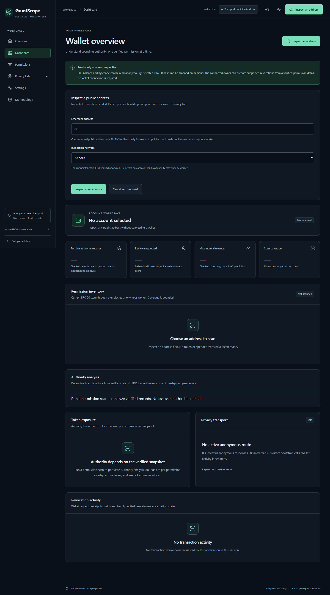
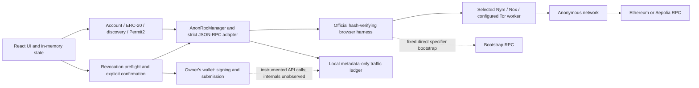

# GrantScope

**See every grant. Understand every risk. Revoke with confidence.**

GrantScope is an MIT-licensed Ethereum permission observatory built for ETHGlobal Mumbai. Inspect a public address without a wallet, read ERC-20 and Permit2 authority through official Anon-RPC workers, understand overlapping permission layers, and request narrowly scoped owner-authorized revocations. Coverage is bounded; the tagline does not mean every permission can be discovered.

**Status:** The application builds and passes deterministic checks. The latest follow-up returned real Nym and Nox responses and displayed the configured 100 GST allowance through the actual UI. Availability remains intermittent; failed sessions are recorded alongside successes. Owner-signed revocation, deployed-origin verification and a published judging recording remain unperformed. The local grant is preserved. Use the [read-only demo check](docs/DEMO_CHECK.md), [test history](docs/TESTING.md) and [submission checklist](docs/SUBMISSION_READINESS.md).



## What it does

- Checksummed arbitrary-address inspection on Ethereum mainnet and Sepolia; native balance, bytecode detection and bounded in-memory history. Code-present owners remain read-only for signing.
- Known/manual ERC-20 pair scans with live metadata, exact BigInt amounts, zero/limited/maximum sizes, progress and failed-read disclosure.
- Bounded owner-filtered Approval discovery with adaptive chunks, duplicate/NFT ambiguity handling, canonical anchors, coverage gaps and fresh allowance verification.
- Canonical Permit2 AllowanceTransfer amounts, expiration and nonce, linked to the actual underlying token approval. Offchain SignatureTransfer signatures are not enumerable.
- Deterministic authority explanations, token groups, filters and session-backed detail pages. Unknown does not mean malicious; overlapping amounts are never summed as loss.
- Owner/network/contract checks, simulation, gas conditions, explicit wallet confirmation, receipt/replacement handling, and fresh anonymous zero-state verification.
- Privacy Lab with actual routes, success/failure/cancellation counts, latency, separate bootstrap/wallet accounting and a locally generated sanitized export.
- Responsive dark/light/system themes, keyboard-accessible Radix dialogs, mobile navigation/cards and honest loading/error/empty states.

## Setup

Use Node 20.19+ in the 20.x line or 22.12+, and npm 10+. CI uses Node 22. No application server, database, API key, private key or seed phrase is required.

```sh
npm ci
npm run dev
```

Open Vite's printed local URL. Use `npm.cmd` in PowerShell if its script launcher is restricted. Chrome was used for executed browser checks. Anon-RPC requires browser capabilities including WebAssembly, WebRTC, Web Crypto and AbortSignal APIs; use HTTPS or loopback localhost.

On Windows, stop local Vite/test servers before rerunning `npm ci`: a running server can lock native dependency binaries and cause `EPERM`. Restart the server after installation succeeds.

Nym is the default worker. Start it explicitly in **Privacy Lab** or by inspecting an address. If it fails, Nox is an explicit Sepolia alternative. Tor requires an operational authenticated KPS gateway. The app never switches to conventional RPC or passthrough. Bootstrap and target chains are separate concepts. [Transport configuration and real failures](docs/ANON_RPC.md) explain the limits.

## Local demonstration configuration

Copy `.env.example` to ignored `.env.local` and set the three optional public variables `VITE_DEMO_OWNER`, `VITE_DEMO_TOKEN`, and `VITE_DEMO_SPENDER`. Leave the committed example empty. No credentials belong in any `VITE_` variable: frontend values are public browser configuration.

The development dashboard's **Load configured Sepolia demo** button performs a real anonymous pair scan and displays its returned allowance. It encodes unsigned approve-to-zero calldata; it never requests signing automatically. Open the verified permission detail, connect the owner in Settings, and separately confirm preparation and wallet authorization when ready. Ordinary address inspection and manual pair entry work independently of this configuration.

Settings explains unsupported wallet networks and owner/network mismatches using the selected inspection. The local Sepolia demo requires Ethereum Sepolia (11155111). Guidance does not change networks or authorize a transaction. [Local setup and current handoff](docs/LOCAL_HANDOFF.md).

The local loader and configured values are excluded from production. Do not copy these identities into README files, fixtures, screenshots, videos or commits. Use a separately consented public demonstration wallet for recordings. Production accepts arbitrary addresses through its ordinary forms. [Demo runbook](docs/DEMO.md).

## Commands and validation

```sh
npm run typecheck
npm run lint
npm run format:check
npm test
npm run test:release
npm run build
npm run check:local-config
npm run demo:check -- --local
npx playwright install chromium
npm run test:e2e
```

To use installed Chrome, set `PLAYWRIGHT_CHANNEL=chrome`. Build first and set `PLAYWRIGHT_PRODUCTION=1` for production browser checks. `PLAYWRIGHT_PORT` selects a local test server port. Ordinary suites skip opt-in external tests; a skip is not live evidence.

Keep the development server running on port 5173 for `demo:check -- --local`. It makes real anonymous reads and verifies the unsigned local workflow without connecting a wallet. If primary Nym fails, explicitly add `--transport nox` for Sepolia. Reports are sanitized and saved only under ignored `.npm-cache/demo-rehearsals/`. [Rehearsal instructions and actual results](docs/DEMO_CHECK.md).

The local demo loader shows its current stage and elapsed time, supports **Cancel demo read**, and stops one attempt after four minutes. After a failed or cancelled Nym attempt, **Try Nox anonymously on Sepolia** requires an explicit click. [Slow-read recovery and real recheck](docs/DEMO_LOADING.md).

`npm run test:live` performs the real public Sepolia diagnostic. Explicitly set `LIVE_TRANSPORT=nox` for the alternative. For the ignored local configuration, run the development server on port 4174 and opt in with `LIVE_LOCAL_DEMO=1`, then run `npx playwright test e2e/local-demo.live.spec.ts --project desktop-chromium --workers=1`. That case disables screenshots, tracing and video. It makes no wallet submission. [Executed checks, failures and reproduction details](docs/TESTING.md).

Before pushing, inspect `git status` and `git diff --cached`, then run `npm run check:local-config`. The guard rejects tracked dotenv files and configured addresses in tracked/staged content. Every module has four cohesive commits.

## Architecture



See [architecture](docs/ARCHITECTURE.md), [file map](docs/FILE_TREE.md), [audit](docs/AUDIT.md), [privacy threat model](docs/PRIVACY.md), [revocation safeguards](docs/REVOCATION.md) and [known limitations](docs/LIMITATIONS.md).

## CROPS

- **C — Censorship resistance:** The frontend can be built and rehosted without our server. It still depends on bootstrap/RPC services and an operational anonymous network; refusal stops reads visibly, with explicit alternative selection and no direct fallback.
- **O — Open source:** MIT-licensed source and lockfile let users build and run the app from this repository. No private application backend or credentials are needed for inspection.
- **P — Privacy:** Hosting sees asset requests; bootstrap services see direct specifier reads; destination RPCs see query contents. No analytics or indexers receive targets. Wallet-internal traffic and public transactions remain outside anonymous-read guarantees.
- **S — Security:** Keys stay in the wallet; application data stays in memory. Narrow actions require owner/network checks, simulation, explicit signing and fresh state verification. The browser, wallet, worker, bootstrap/provider data and dependencies remain trust assumptions; there is no independent audit.

The [official EF prize page](https://ethglobal.com/events/mumbai/prizes#ethereum-foundation) is mapped to actual code/evidence in [PRIZE_COMPLIANCE](docs/PRIZE_COMPLIANCE.md). CROPS has its own published criteria; it is not a claim of guaranteed privacy or universal censorship resistance.

## Deployment and screenshots

`vercel.json` supplies the Vite build, static output, SPA deep links and basic privacy/security headers. `.vercelignore` excludes local environment and test artifacts. Import this repository into Vercel with `npm ci`, `npm run build`, and output `dist`; do not upload local demo variables. [Deployment checks](docs/DEPLOYMENT.md) must be run against the actual HTTPS origin before publishing a demo URL. No deployed URL exists in this repository's evidence.

After your Vercel deployment finishes, run `npm run verify:deployment -- https://your-deployment.vercel.app` for route/header/asset checks, then `npm run test:hosted -- https://your-deployment.vercel.app` for desktop/mobile browser checks. These commands do not sign or submit transactions. Hosted tests disable the private local-demo case; real anonymous worker checks remain a separate explicit opt-in. [Private post-revocation verification](docs/DEMO.md#private-verification-after-owner-confirmation) keeps the actual transaction hash out of public output and commits.

[Screenshot instructions](docs/SCREENSHOTS.md) distinguish actual UI captures, historical worker evidence, and excluded local target data. The component workshop is development-only and its fictional fixtures never enter production.

## AI usage disclosure

OpenAI Codex assisted implementation, testing, debugging and documentation. Automated tests use clearly isolated mocks; live integration claims come from executed worker/browser responses. AI does not manage keys, authorize wallet transactions, establish maliciousness or certify anonymity. Human review and wallet confirmation remain required.

## Submission links

- [Public source repository](https://github.com/Joel-29/GrantScope)
- [ETHGlobal Mumbai prize requirements](https://ethglobal.com/events/mumbai/prizes#ethereum-foundation)
- Hosted application, judging video and project submission URL: **not published or verified yet**.

Licensed under [MIT](LICENSE).
