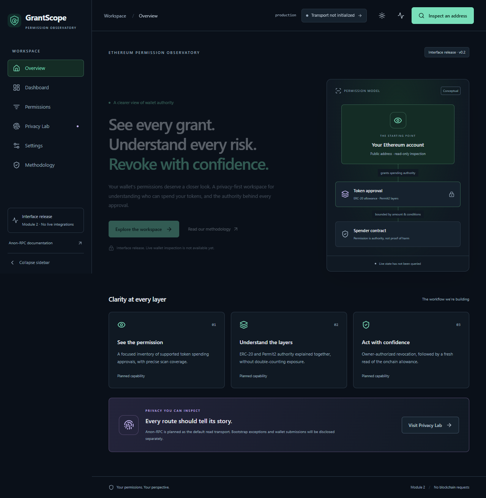

# GrantScope

See every grant. Understand every risk. Revoke with confidence.

GrantScope is an MIT-licensed Ethereum permission observatory in development for ETHGlobal Mumbai. It aims to make supported ERC-20 and Permit2 spending authority understandable, with application-owned chain reads routed through Anon-RPC by default.

**Current status: Module 8 ? deterministic authority analysis.** Anonymous account inspection, ERC-20 scans, bounded event discovery and Permit2 grant/dependency reads feed explained per-permission bounds and grouped detail views. Unknown spenders are not called malicious; overlapping layers are never summed. Nym is primary, with explicit Nox Sepolia after failure and optional configured Tor. Signing is the next module. See [analysis](docs/EXPOSURE.md), [Permit2](docs/PERMIT2.md) and [transport evidence](docs/ANON_RPC.md).

## Problem and intended solution

Token approvals can outlive the interaction that created them. Permit2 adds additional authorization layers. GrantScope will bring supported permissions into one workspace, explain their bounds and overlap, and verify owner-authorized revocations with fresh chain reads. Coverage and privacy exclusions must remain visible.

## What works now

- Semantic design tokens, dark/light/system themes, collapsible desktop navigation, and a Radix mobile dialog.
- Landing page, dashboard account/summary cards, desktop permissions table and mobile card layouts, Privacy Lab, settings, methodology, and 404 states.
- Accessible inspection-boundary dialogs and transaction-activity drawer; loading skeletons, empty states, error recovery, and native labeled form controls.
- Development-only component workshop with explicitly fictional fixtures, search/filter previews, loading and error states. The route and fixture content are excluded from production; the build checks this boundary.
- Strict TypeScript, Tailwind CSS, Lucide icons, reduced-motion-aware Motion, TanStack Query provider, in-memory Zustand preferences, and Zod environment validation.
- Vitest/Testing Library tests, Playwright desktop/mobile coverage, ESLint, Prettier, and CI configuration.
- Static Vercel build and SPA rewrite configuration. No deployment has been created.

## Setup

Use Node **20.19+ in the 20.x line, or 22.12+**, and npm 10+. Node 22 LTS is used in CI. Install dependencies once, then use the lockfile for repeatable installs:

```sh
npm ci
npm run dev
```

Open the local URL printed by Vite (normally `http://127.0.0.1:5173`). If no lockfile is present in a source copy, run `npm install` first to generate it. On Windows where PowerShell blocks `npm.ps1`, use `npm.cmd` for these commands. No execution-policy change is necessary.

The optional `.env.example` can be copied to `.env.local`; the app runs without it. `VITE_APP_ENV` accepts `development`, `test`, or `production` and only controls the UI label. **Every `VITE_` value is public browser configuration. Never put a private key, seed phrase, or secret there.** No RPC URLs or worker addresses are configured in Module 1.

## Commands

| Command                | Purpose                                          |
| ---------------------- | ------------------------------------------------ |
| `npm run dev`          | Local development server                         |
| `npm run typecheck`    | Strict application and tooling TypeScript checks |
| `npm run lint`         | ESLint, hooks, and accessibility rules           |
| `npm run format:check` | Verify Prettier formatting                       |
| `npm run format`       | Apply formatting                                 |
| `npm test`             | Deterministic foundation tests                   |
| `npm run test:watch`   | Interactive Vitest                               |
| `npm run build`        | Typecheck and build static `dist/` output        |
| `npm run preview`      | Serve the production build locally               |
| `npm run check`        | Typecheck, lint, formatting, unit tests, build   |
| `npm run test:e2e`     | Playwright shell smoke tests                     |

Before the first browser test, run `npx playwright install chromium` (Linux CI uses `--with-deps`). Browser tests start and stop their own Vite server. These tests validate the foundation; they are **not** evidence of functioning anonymous RPC or real transaction behavior.

## Routes

`/` · `/dashboard` · `/permissions` · `/permissions/:id` · `/privacy` · `/settings` · `/about`

Unknown routes render a useful 404 page. Secondary pages are lazy-loaded. Permission IDs are not treated as verified allowance records.

During `npm run dev`, visit `/design-system` or use the component workshop link in Settings. It is an isolated UI preview with a persistent fictional-data notice. `npm run build` removes the route, link, and fixture payloads. Production `/design-system` resolves to the regular 404 page. See [DESIGN_SYSTEM](docs/DESIGN_SYSTEM.md).

## Architecture

```text
src/app          Routing, providers, application composition
src/components   Layout and reusable accessible UI
src/pages        Route-level presentation
src/features     Reserved boundaries for later independently tested modules
src/lib/config   Public environment validation
src/store        In-memory UI preferences
src/styles       Local CSS and Tailwind theme
src/design-system Development-only workshop and isolated fictional fixtures
src/test         Deterministic shell tests
e2e              Browser smoke tests
scripts          Production fixture-isolation check
docs             Architecture, privacy, limitations, and implementation status
```

See [ARCHITECTURE](docs/ARCHITECTURE.md). Blockchain services stay separate from presentation. Module 3 integrates viem and the official `@anon-rpc/browser-harness`; a wallet signing adapter will be introduced separately. Workers are not initialized until explicitly requested.

Module 3 now uses viem and the official harness through a fail-closed adapter. Read-only wallet inspection and signing are still pending. Use `npm run test:live` only when intentionally running the real external worker diagnostic; ordinary unit/browser tests do not establish anonymity.

See the [complete file tree](docs/FILE_TREE.md) for every source and configuration file.

## CROPS

- **Censorship resistance:** planned interchangeable anonymous RPC routes; no operational transport yet.
- **Open source:** MIT license and reproducible source setup. Source is maintained in [Joel-29/GrantScope](https://github.com/Joel-29/GrantScope).
- **Privacy:** no analytics, remote fonts, indexers, or persisted wallet records. Chain reads use anonymous workers; fixed specifier bootstrap exceptions are direct and disclosed. The official worker has a separate IndexedDB namespace. Wallet-provider traffic remains outside these guarantees.
- **Security:** truthful unavailable states, strict types, no signing or permission-changing code, and automated shell checks. No security audit has been performed.

See [CROPS](docs/CROPS.md), [PRIVACY](docs/PRIVACY.md), and [LIMITATIONS](docs/LIMITATIONS.md).

## Networks and demo

Sepolia anonymous reads have returned real responses through Nym and Nox. Nym also experienced transient request timeouts; Tor's demonstration gateway is unavailable and optional Tor needs an operational KPS gateway. Mainnet is a configured target, not yet independently verified through this diagnostic. The specifier chain and queried chain are separate concepts. No deployed test token or revocation transaction evidence exists yet. See [ANON_RPC](docs/ANON_RPC.md), [DEMO](docs/DEMO.md), and [TESTING](docs/TESTING.md).

## Screenshots

Actual Module 2 shell, captured in Chrome through Playwright:



[Mobile overview screenshot](docs/screenshots/overview-mobile.png). These images contain no example balances or fabricated scan results. Ongoing browser verification artifacts belong in ignored `test-results/`.

[Dark dashboard](docs/screenshots/dashboard-dark.png) · [Light dashboard](docs/screenshots/dashboard-light.png) · [Light mobile settings](docs/screenshots/settings-mobile-light.png)

## Deployment and submission

For a later authorized Vercel deployment, import the repository, choose Vite, use `npm run build`, and serve `dist/`. `vercel.json` contains SPA routing and baseline response headers. No backend, production credentials, hosting account, or submission URL is provisioned here. Revisit worker/CSP isolation requirements before deploying the transport integration.

- [ETHGlobal Mumbai prize requirements](https://ethglobal.com/events/mumbai/prizes#ethereum-foundation)
- [Prize compliance status and known gaps](docs/PRIZE_COMPLIANCE.md)
- Source repository: [Joel-29/GrantScope](https://github.com/Joel-29/GrantScope)
- Deployment: not created
- ETHGlobal submission: not submitted

## Required integration references

Reviewed while preparing the foundation; re-verify APIs, live addresses, and supported chains immediately before integration. Documentation is not proof of an operational local transport.

- [Anon-RPC overview](https://ethereum.github.io/anon-rpc/)
- [Wallet/application guide](https://ethereum.github.io/anon-rpc/wallets/)
- [Official adopters and worker specifiers](https://ethereum.github.io/anon-rpc/adopters/)
- [Anon-RPC source](https://github.com/ethereum/anon-rpc)
- [Permit2 overview](https://developers.uniswap.org/docs/protocols/permit2/overview)
- [AllowanceTransfer concepts](https://developers.uniswap.org/docs/protocols/permit2/concepts/allowance-transfer)
- [Permit2 source](https://github.com/Uniswap/permit2)

## AI usage disclosure

The Module 1 foundation and Module 2 design system, UI, tests, and documentation were generated with assistance from OpenAI Codex from the project brief. Human review and real integration testing remain necessary. No UI or mock test should be presented as evidence that Anon-RPC or revocation works.

## Module boundary

The user explicitly requested Modules 3–12 in sequence. Each module is validated and pushed in exactly four cohesive conventional commits before the next requested module; this standing instruction is recorded in [AGENTS.md](AGENTS.md). Unexecuted or failed live checks are never reported as passing.
