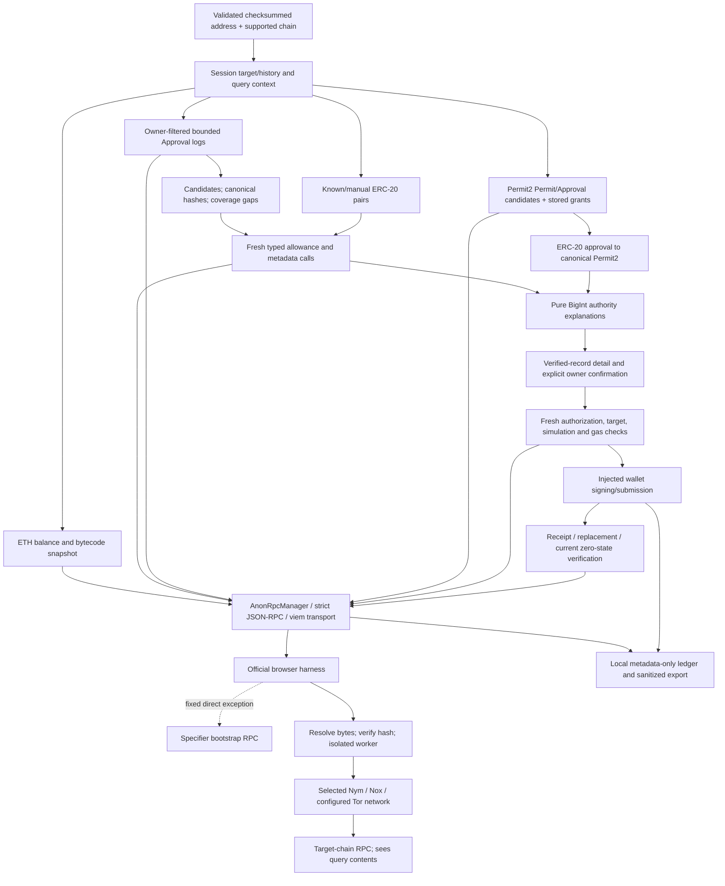

# Architecture

GrantScope is a client-side Vite/React application. Presentation, account/wallet state, ERC-20 inspection, historical discovery, Permit2, deterministic analysis, revocation and traffic reporting have separate feature boundaries. There is no application database, address indexer, analytics backend or signing key service.

`AnonRpcManager` owns one long-lived selected worker and its lifecycle, code identity, strict direct-bootstrap capability, read method/chain admission, abort/deadline bound and centrally measured outcomes. `JsonRpcAdapter` validates envelopes and bounded response bodies, and exposes a viem custom transport with no ordinary provider or implicit transport fallback. Nym is primary. Nox is constrained to the tested Sepolia use case and keeps TLS required. Tor needs a reachable authenticated KPS gateway.

The bootstrap chain resolves worker identity; the target chain supplies account state. They need not match. The original SDK code verification and null-origin sandbox remain intact. Hash integrity relies on bootstrap data and worker publication trust; this is not a light-client state proof.

Reads verify chain identity and use explicit block snapshots. Account/ERC-20/Permit2 readers recheck canonical anchors; discovery checks event block hashes and range anchors. In-memory query keys isolate chain, owner, manager context and explicit inspection revision. Metadata reuse is limited to a single scan, owner and block. Failed reads stay unknown. Failed refreshes retain clearly older snapshots; a verified zero result supersedes earlier positive assessments.

Permit2 stored grants and the token approval to Permit2 are dependent layers, not additive exposure. Pure analysis computes per-permission bounds and explains classifications without predicting theft or inventing USD losses. SignatureTransfer signatures remain outside enumerable inventory.

The wallet wrapper permits account/network metadata and explicit submission only. All application preflight, gas/nonce, receipt and verification reads remain anonymous. Final revoked status requires a matching successful canonical transaction and a fresh zero allowance; wallet confirmation or a receipt alone is insufficient.

Traffic records omit parameters, addresses and raw results/errors. A bounded record window and full-session counters have separate accounting. Worker and wallet internals are not completely observable. The local demo loader and fictional design workshop are separate development-only imports excluded by the production build guard.
